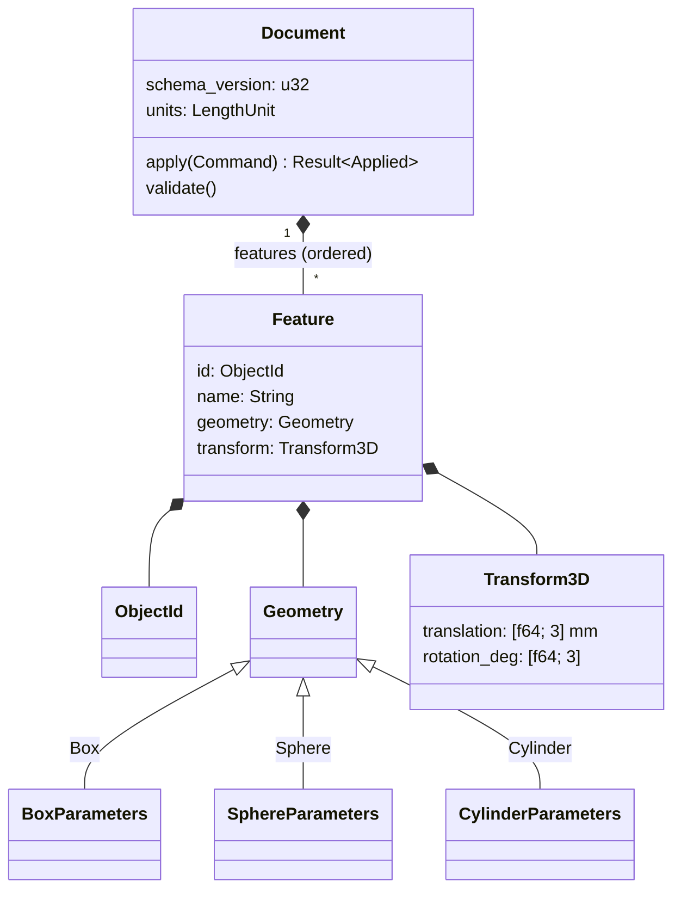
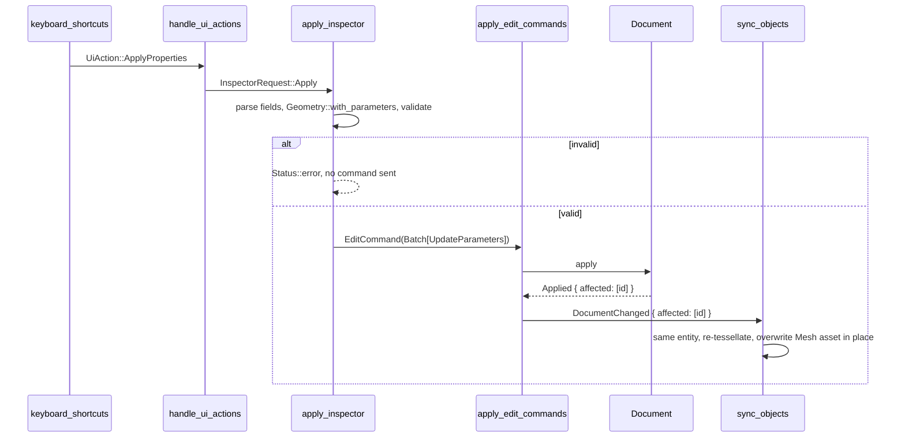

# Architecture

This page explains how the code is organized and how one edit travels from a click to the
screen. For the reasons behind these choices, see [decisions.md](decisions.md).

## Principles

1. **Parameters are the source of truth.** Meshes, entities, and UI state are derived from
   the document and can be rebuilt from it at any time.
2. **The core knows nothing about Bevy, windows, or files.** `cad-core` compiles and is
   tested without a GPU, a window, or filesystem access.
3. **One way to change the document.** All mutations go through `cad_core::Command`.
   Commands are validated and atomic.
4. **Incremental updates.** An edit touches only the entities of the objects it changed.

## Workspace layout

```
rust-parametric-cad/
├── Cargo.toml                 workspace; pins bevy = "=0.19.1"
├── examples/demo.cad.json     sample project (checked by a test)
├── docs/                      this documentation
└── crates/
    ├── cad-core/              library: domain model (no Bevy)
    │   ├── src/
    │   │   ├── lib.rs         re-exports the public API
    │   │   ├── units.rs       LengthUnit, mm <-> m
    │   │   ├── validation.rs  ValidationError and rule functions
    │   │   ├── parameters.rs  BoxParameters, SphereParameters, CylinderParameters
    │   │   ├── geometry.rs    Geometry, PrimitiveKind, tessellation -> TriMesh
    │   │   ├── feature.rs     ObjectId, Transform3D, Feature
    │   │   ├── document.rs    Document, DocumentError, CURRENT_SCHEMA_VERSION
    │   │   ├── command.rs     Command, Applied (inverse + affected ids)
    │   │   └── persistence.rs to_json / from_json, PersistenceError
    │   └── tests/             integration tests
    └── cad-app/               binary: Bevy desktop editor
        └── src/
            ├── main.rs        entry point
            ├── app.rs         window config, DefaultPlugins, demo document
            ├── plugins.rs     CadEditorPlugins (plugin group)
            ├── editor.rs      CadDocument, Selection, Status; EditorSystems sets
            ├── commands/      applying commands; project file IO
            ├── viewport/      camera, scene, core->Bevy conversion, entity sync, picking
            └── ui/            layout, toolbar actions, object list, inspector, shortcuts
```

Dependency direction: `cad-app → cad-core`. Never the other way.

## The core (`cad-core`)

### Data model



How the model protects its invariants:

- The parameter structs, `Feature`, and `Document` have **private fields**. In code, values
  can only be built through validating constructors (`BoxParameters::new`, `Feature::new`,
  `Document::new`), so every such value is valid.
- Deserialization skips those constructors. That is why `from_json` always calls
  `Document::validate` afterwards.
- `Feature` setters are `pub(crate)`, so only commands can call them.

### Commands

```rust
pub enum Command {
    CreatePrimitive { id, name, geometry, transform },
    UpdateParameters { id, geometry },
    RenameObject { id, name },
    DeleteObject { id },
    SetObjectTransform { id, transform },
    InsertFeature { index, feature },   // inverse of DeleteObject
    Batch(Vec<Command>),                // all or nothing
}
```

`Document::apply(command) -> Result<Applied, DocumentError>`:

- **Validation first.** Each command validates its input before it mutates anything. On
  `Err`, the document is unchanged.
- **Batch.** A batch runs on a clone of the document and replaces the original only if every
  command in it succeeds.
- **Result.** `Applied { inverse, affected }`. Applying `inverse` restores the previous
  state exactly, including the position of a deleted feature. `affected` lists the IDs of
  the objects that changed.
- **Caller-chosen IDs.** `CreatePrimitive` carries its ID, so replaying it (for example for a
  redo) recreates the same object. `Command::create` generates a fresh ID for convenience.

### Geometry pipeline

```
BoxParameters ──┐
SphereParameters├─▶ Geometry ──tessellate(&Tessellation)──▶ TriMesh (mm, f64, Z-up)
CylinderParams ─┘
```

`TriMesh` is an indexed triangle list with per-vertex normals and counter-clockwise front
faces. Tests check the bounding boxes and that every triangle faces outward. A future B-rep
kernel can replace `tessellate` without changing the document model.

`Geometry::parameters()` and `Geometry::with_parameters(&[(key, value)])` give generic,
key-based access to the parameters. The inspector uses them, so it needs no code specific to
a primitive.

## The app (`cad-app`)

### Plugins

`app::build_app` adds Bevy's `DefaultPlugins` (with the window configuration) and then
`CadEditorPlugins`:

| Plugin | Adds |
| --- | --- |
| `EditorStatePlugin` | Resources `CadDocument`, `Selection`, `Status`; orders the `EditorSystems` sets |
| `CommandsPlugin` | Messages `EditCommand`, `ProjectCommand`, `DocumentChanged`; the systems that apply them |
| `ViewportPlugin` | `MeshPickingPlugin`, scene (lights, grid, axes), orbit camera, object sync and selection |
| `EditorUiPlugin` | `TabNavigationPlugin`, UI layout, the systems that handle actions, the list, the inspector, and the status bar |

### Messages

| Message | Sent by | Handled by |
| --- | --- | --- |
| `UiAction` | buttons, keyboard shortcuts | `ui::handle_ui_actions` |
| `InspectorRequest::{Apply, Revert}` | `handle_ui_actions` | `inspector::apply_inspector`, `inspector::rebuild_inspector` |
| `EditCommand(Command)` | UI | `commands::apply_edit_commands` |
| `ProjectCommand::{New, Open, Save}` | UI | `commands::handle_project_commands` |
| `DocumentChanged { affected, reloaded }` | command handlers, and once at startup | object sync, object list, inspector |
| `ResetCamera` | UI | `camera::reset_camera` |

### Frame schedule

Each frame runs three ordered system sets in `Update`:

```
EditorSystems::Input     buttons/keys -> UiAction -> EditCommand / ProjectCommand
                         inspector Apply -> one Batch command
                         camera input (orbit / pan / zoom)
        │
EditorSystems::Commands  apply_edit_commands, handle_project_commands
                         -> mutate CadDocument, set Status / Selection,
                            write DocumentChanged
        │
EditorSystems::Sync      sync_objects, highlight_selection,
                         rebuild_object_list, rebuild_inspector,
                         status bar, button/field visuals
```

Because of this order, an edit appears on screen in the same frame it is made.

### Life of an edit

What happens when you change a sphere's radius to 90 and press Enter:



### Mapping objects to entities

- `ObjectEntityMap: HashMap<ObjectId, Entity>` is the only link between document objects
  and Bevy entities. Entity IDs are never stored in the document.
- Each render entity has `CadObject { id }` and `RenderedGeometry(Geometry)`.
- For every affected ID, `sync_objects` compares the document with the map:

  | In document | In map | Action |
  | --- | --- | --- |
  | yes | no | spawn the entity (mesh, material, transform) as a child of the CAD root |
  | yes | yes | update the transform and name; re-tessellate only if the `RenderedGeometry` differs |
  | no | yes | despawn the entity and remove it from the map |

- When `reloaded` is true (after New or Open, and at startup), every ID from the document
  and from the map is synced.

### Coordinate frames and units

| | Document (`cad-core`) | Bevy world |
| --- | --- | --- |
| Length unit | millimeter, `f64` | meter, `f32` |
| Up axis | +Z | +Y |
| Angles | degrees | radians (quaternions) |

`viewport/convert.rs` is the only place where these conversions happen:

- `mesh_from_trimesh` converts the core mesh to meters and builds a Bevy `Mesh`.
- `transform_from_cad` converts a `Transform3D` to meters and radians, using
  `EulerRot::ZYX` so that `R = Rz·Ry·Rx`.
- `CAD_TO_BEVY` is a −90° rotation about X. It is set on a single **CAD root** entity, and
  every object entity is a child of that root. Object transforms therefore stay in CAD terms,
  and the change of frame happens exactly once. CAD (x, y, z) maps to Bevy (x, z, −y).

### Input handling details

- **Is the pointer over the UI?** `PointerOverUi` checks whether Bevy's picking `HoverMap`
  contains any UI `Node`. Transparent layout containers have `Pickable::IGNORE` so they do
  not block the viewport.
- **Selection.** A global observer on `Pointer<Click>` handles selection. Picking events
  bubble up to parent entities and finally to the window, so the observer uses
  `original_event_target()` and only reacts to the first, un-bubbled trigger. A hit on a
  `CadObject` selects it, a hit on the window deselects, and a hit on UI is ignored.
- **Camera.** The orbit camera computes drag deltas from the window cursor position, not
  from raw mouse motion, so panning tracks the cursor exactly. A drag starts only over the
  viewport but continues over the panels.
- **Text fields** use Bevy's `EditableText` widget. Keyboard shortcuts check `InputFocus` so
  that typing in a field does not trigger them.

### Persistence boundary

```
UI (path) ─▶ ProjectCommand ─▶ commands/project.rs ─▶ std::fs  (desktop only)
                                     │
                                     ▼
                     cad_core::{to_json, from_json}  (strings only)
```

To use different storage (for example browser storage in Phase 2), replace
`commands/project.rs`. Nothing else needs to change.
